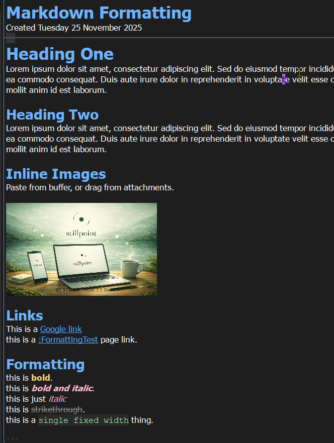

# Editor

StillPoint’s editor is a Markdown editor designed for fast note-taking, linking, and task tracking.

## Quick Start
- Type normally. Your page auto-saves as you edit.
- Use headings to structure your page.
- Add links between related pages.
- Add tasks directly inside notes.

## Page Preview and Editing
Use **Reading View** for a rendered page preview with formatted headings, links, images, and tables. Use **Edit View** to write and change the underlying Markdown.

Reading View keeps the editor's theme colors for headings, bold and italic text, and fixed-width text, including when using Folder Navigator.

- Press `Ctrl+Space` (`Cmd+Space` on macOS) to switch views, or use the view button in the bottom editor bar.
- Both views show the same page. Switching views does not create a separate copy; edits appear in Reading View when you switch back.
- Reading View supports following links and finding text. Switch to Edit View to change text or insert content.
- Vault permissions still apply in Edit View. Read-only vaults, including the help vault, allow reading, navigation, selection, and copying, but block typing, pasting, and dropping links or attachments into the page.

With vi navigation enabled, the **Line Outline Cursor** frames the active visual line in the vault or folder accent color. Text colors and the line background remain readable inside the outline. The same cursor is used by Folder Navigator's Markdown editor and the Focus and Audience editors.

### Copying Content

**Copy** (`Ctrl+C`, or `Cmd+C` on macOS) works the same in StillPoint and Folder Navigator, in both editing and reading views. It copies clean formatted HTML for email and rich-text applications, with readable plain text as a fallback. Headings, emphasis, links, lists, tables, and code are preserved without the reader's theme colors, font sizes, or page layout. Pasting between StillPoint editors also preserves the underlying Markdown.

Use **Copy as Plain Text** from the context menu for unformatted readable text, or **Copy as Markdown** for source syntax. The copy buttons on reading-view tables and code blocks remain explicit **Copy Markdown** actions.

### Reading Options

The book icon in the bottom bar opens **Reading options**. Choose Narrow, Comfortable, Wide, or Full width; adjust text size independently of the editor; and select Compact, Normal, or Relaxed line spacing. Subtle alternating table rows can be turned off here. These preferences are remembered across sessions and shared with Folder Navigator.

Wide code and tables use the reader's horizontal scrollbar when needed.

Hold the pointer over a table for three-quarters of a second to open a larger read-only table preview. Move the mouse or press `Escape` to dismiss it. This works in both Markdown editing and reading views, including Folder Navigator.

Switching between reading and editing preserves your source position, including individual table rows and code lines, even when the two views use different sizes or widths.

Use the focus icon to hide navigation and top controls temporarily. Press `Escape` or click the icon again to restore the previous layout. If Find or the options popup is open, the first `Escape` closes that control.

The floating collapsible table of contents navigates headings and offers **Copy Link Location** on a heading's context menu. Code blocks and tables have a **Copy Markdown** button at their upper-right edge: code includes its fences and language label, while tables include their Markdown header and alignment row. A checkmark and **Copied** confirm the action.

## Markdown Basics
StillPoint uses standard Markdown with a few workflow-friendly additions.

It visual like a word processor, but `plain text` on your disk.



### Headings
- `#` main title
- `##` section
- `###` subsection
- You can type heading markers directly, or use shortcuts: `Ctrl+1` to `Ctrl+5`.

### Text Formatting
- `*italic*` or `_italic_`
- `**bold**` or `__bold__`
- `` `code` `` for inline code
- You can also apply formatting from keyboard shortcuts in the Format menu.

### Lists
- `-` for dash lists
- `•` for bullet lists
- `- [ ]` for checkbox task lists
- Focus on bullets and task lists as your primary structure.

### Links
- `[text](url)` for external links
- `:PageName` for internal page links
- `[:PageName|Display Text]` for custom link labels
- Best practice: create links with `// ` (quick link picker), `Ctrl+L`, or by creating a new page (`Ctrl+N` or right-click -> `New Page`).

### Code Blocks
```language
code here
```

## Tasks in Notes
Tasks live directly in your pages, so planning and notes stay together.

- Type `()` then space to create a new task
- Type `(x)` then space to create a completed task
- Press `F12` on a task line to toggle complete/incomplete in any editor mode
- Press `Ctrl+Alt+E` on a task line to open the Task Editor in any editor mode
- In vi navigation mode, use `Space` to toggle complete/incomplete or `e` to open the Task Editor
- Add task tags with `@tagname` (example: `@errands`, `@email`)

You can also add date markers in task text:
- `<2026-02-16` for due-style dates
- `>2026-03-30` for start-style dates

Example:
```markdown
- [ ] Buy supplies @errands <2026-02-16
- [ ] Draft launch email @email >2026-03-30
```

## Inline Helpers
- Page tags: type `/# ` to browse existing page tags and insert one
- Task tags: type `/@ ` on a task line to browse task tags and insert one
- AI prompt: type `/ai ` (trailing space) to open inline AI prompt when AI is enabled

## Find and Replace
- `Ctrl+F` to find text on the current page
- `Ctrl+H` to replace text
- In VI mode, use `/` for quick in-page search and replace

## Moving Content
- Right-click in the editor and use `Move -> Move Text…` to move selected text to another page.
- Right-click in the editor and use `Move -> Move Page…` to move the current page with the standard move-page dialog.
- In VI mode, `m` keeps the same mental model:
  - With a selection, it moves the selected text.
  - With no selection, it opens the move-page dialog for the current page.

## Printing
- Printing is powerful: print a page to the browser for clean output/PDF export, or print page-tree views for structured sharing.
- Use `File -> Print`, `Ctrl+P`, or right-click menus.

## Working Modes and Extras
- Use the editor for normal writing, journaling, task tracking, and link-based knowledge work.
- Open important pages in separate editor windows when you want side-by-side focus. `Page/Open Page in new Editor`.
  - This is great for reviewing several pages while consolidating notes into one page.
- Use related panels (like navigation and outline/toc features) to move through long pages faster.
- Focus Mode is great when you want distraction-free writing and cleaner concentration.
- If AI is enabled, use inline `/ai ` prompts and AI panels to draft, summarize, and iterate faster without leaving your notes.
- Audience Mode is useful for sharing notes live, with larger readable text and reduced editing clutter.

## New User Tips
- Start simple: one page per topic, connected by links.
- Use headings early so pages stay easy to scan.
- Keep tasks close to the notes they belong to.
- Add tags only when you feel real grouping pain.

## Voice Notes and Screen Recording

Use the microphone or video-record icon beside Print, the matching buttons in Attachments, or **Record Voice Note** / **Record Screen** in the command palette. Recordings attach to the page where you started. See [:Recording] for recording, playback, transcription, tray controls, and global pause/stop shortcuts.
