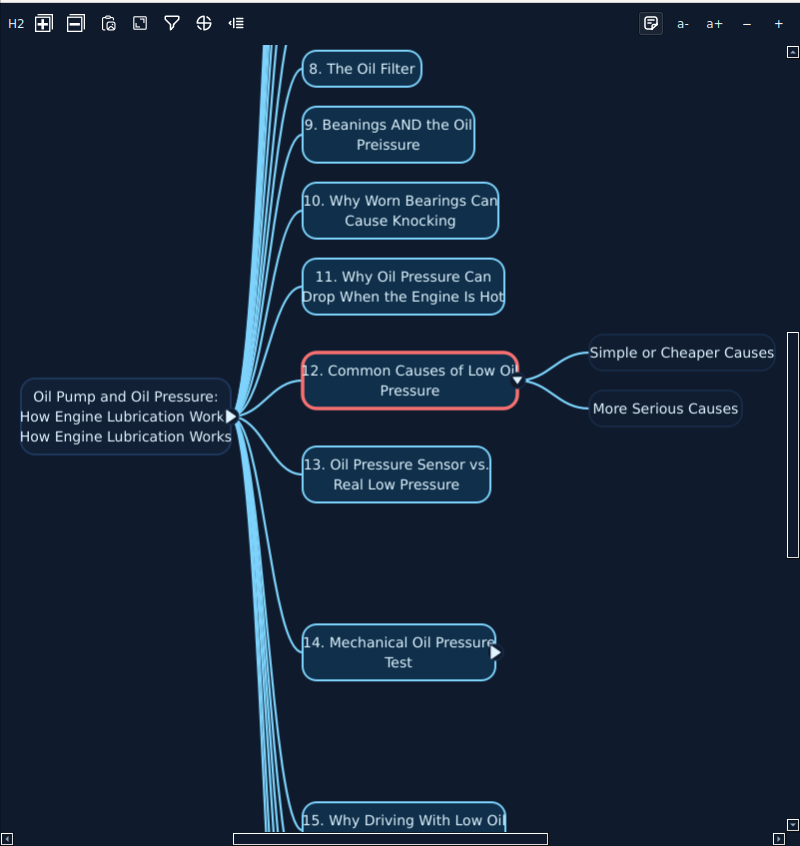
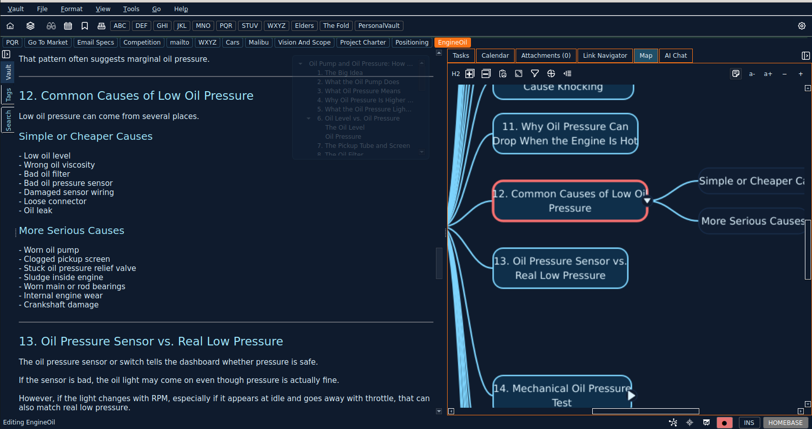

# Mindmap Mode

Mindmap Mode gives you a visual way to read and shape a markdown page.

You are still editing the same page. StillPoint simply presents the structure as connected heading nodes so you can think in branches, then drop back into text as needed.

## What You Can Do
- Visualize markdown structure as a mindmap.
- Read through long documents more visually.
- Brainstorm and take notes while reshaping page structure.
- Move nodes and regroup sections to achieve the structure you want.
- Flip back and forth between document authoring and visual structure.
- Filter the hierarchy to focus on just one part of a complex page.

## Mindmap Workflows
### Full Page Mindmap View
Open a dedicated full-page map window to focus on structure and visual reading.

Opening the map again reuses its existing window and brings it forward. The map follows the editor’s current page and cursor: it selects, expands, and centers the containing heading, including when the cursor is in the heading’s body. Existing full-screen or windowed mode is preserved.

### Side-by-Side with Document Authoring
Use the Map tab while editing the page so structure and writing evolve together.

## How to Open Mindmap Mode
- Right-click in the editor and choose `View -> View in Map Mode`.
- Click the status bar mindmap icon (`Open in Mindmap mode`).
- Use the right panel Map tab for side-by-side editing.

## Practical Tips
- Use map filtering when the page gets large.
- Keep one branch expanded while drafting.
- Use the map to plan section flow first, then refine details in markdown.

## Keyboard Navigation and Editing
Click **?** in the map toolbar, or press `?`, to open the floating keyboard help window. It includes vi equivalents when vi mode is enabled.

| Action | Standard keys | Vi keys (when enabled) |
| --- | --- | --- |
| Navigate | Arrow keys | H / J / K / L |
| Review selected content | Enter | Enter |
| Expand or collapse branch | Space | Space |
| Reveal heading (Map tab) / edit body (map window) | Ctrl+Enter | Ctrl+Enter |
| Rename heading | F2 | i |
| Add sibling below | Shift+Enter | o |
| Add sibling above | — | Shift+O |
| Add child | Ctrl+I / Insert | a |
| Delete an empty heading | Delete | dd |
| Move branch up / down | Ctrl+Up / Ctrl+Down | Ctrl+K / Ctrl+J |
| Indent / outdent branch | Ctrl+Right / Ctrl+Left | Ctrl+L / Ctrl+H |
| Extend sibling selection | Shift+Up / Shift+Down | Shift+U / Shift+N |
| Zoom in / out | Alt+Up / Alt+Down | Alt+K / Alt+J |
| Fit map / center selection | F / Alt+C | F / Alt+C |
| Move to another parent | Ctrl+X, navigate, Ctrl+V | Same |
| Undo / redo | Ctrl+Z / Ctrl+Shift+Z | u / Ctrl+R |

To add a node, select an existing node and use Shift+Enter for a sibling or Ctrl+I (Insert also works) for a child. Type its heading, then Enter to save or Esc to cancel. Letters enter text normally while adding or renaming.

To move a branch to another parent, select it, press Ctrl+X, navigate to the destination, and press Ctrl+V. A dashed outline marks the pending branch; Esc cancels. The destination receives the branch as its last child, including all content and descendants. Dragging onto another node performs the same move. Moves apply immediately; Ctrl+Z undoes them.

In the review popup, Up / Down scroll by line and PageUp / PageDown scroll by page. Vi mode adds J / K and Ctrl+D / Ctrl+U. Esc returns focus to the map. Ctrl+Space also toggles the review popup.

Alt+[ filters to the selected subtree and Alt+] clears the filter. PageUp / PageDown adjusts the visible heading depth. Esc in the map collapses it back to the root/title node and centers it.

In the Map tab, Ctrl+Enter scrolls to and highlights the selected heading in the Markdown editor while keeping keyboard focus in the map. It also works from the review popup.

In a detached map window (full screen or windowed), Ctrl+Enter opens a small Markdown editor for the selected heading’s body. The heading name and child sections stay separate. Ctrl+Enter saves; Esc or clicking outside the popup cancels the unsaved draft. With vi enabled, the popup uses the same vi editing keys as the main editor: i enters insert mode and Esc returns to navigation mode before a second Esc cancels. Without vi, type normally and Enter inserts a newline. StillPoint links render visually but do not navigate from this popup. Saving returns to the selected map node and starts a fresh map undo history. Map undo covers visible heading and structure changes; body content is excluded so it cannot be silently reverted from the map. If the page changes while the popup is open, the popup keeps your draft and asks you to reopen the latest content before saving.

Delete removes a heading only when its own body is empty (blank lines are allowed). In vi mode, press `dd`. Children move up into the deleted heading’s place, keeping all their content. Deletion supports map undo. If the heading has body content, its border flashes red/white three quick times and a red status line at the bottom shows: “node has body content, not deleting”.

A tiny dot at the lower-left of each node indicates its own body content: filled means content is present; hollow means empty. Child sections do not count as the parent’s body.
