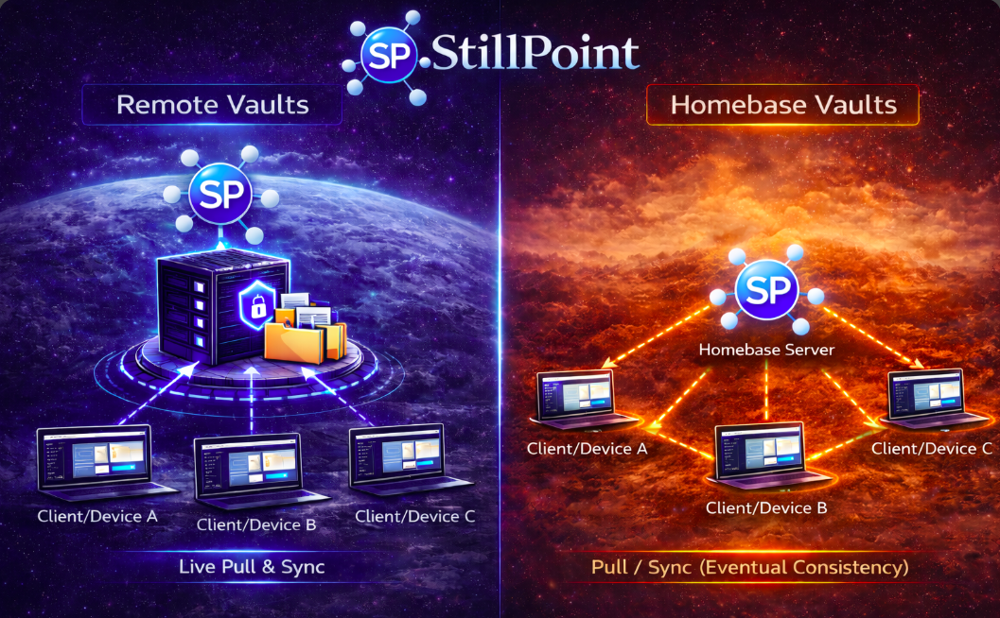

# Sync & Sharing

{width=600}

Your vault is yours: a real folder of Markdown pages and attachments that works locally first. When you want that vault on another computer—or want to collaborate—StillPoint gives you three strong ways to take it further:

- **Cloud Folder** for familiar, low-friction sync through OneDrive or Google Drive.
- **Git** for precise history, deliberate publishing, and technical collaboration.
- **Homebase** for StillPoint-native, encrypted, offline-first sync that you control.

There is no single “correct” choice. Pick the superpower that matches the vault. You can keep a private journal local, put family notes in a Cloud Folder, run a project vault through Git, and host a sensitive knowledge base on Homebase. StillPoint has you covered.

## Pick Your Mode

| Mode | Best for | Biggest strengths | Know before you choose |
| --- | --- | --- | --- |
| **Cloud Folder** | Personal vaults across a few computers | Easiest setup; uses OneDrive or Google Drive you already know; automatic file sync | Keep the entire vault available offline and do not open it on two computers at once |
| **Git** | Developers, teams, auditable projects, and publishing workflows | Exact history; branches and hosting options; reviewable changes; deliberate pull/save/publish flow | Requires Git comfort; normal Git remotes receive plaintext vault files; conflicts need an explicit decision |
| **Homebase** | Private multi-device vaults, self-hosting, and managed team access | Encrypted server objects; local-first/offline work; user roles; conflict review and local recovery | Requires a Homebase server, account, and encryption passphrase management |

**Want the shortest answer?** Choose Cloud Folder for convenience, Git for history and collaboration, or Homebase for private StillPoint-native sync and control.

## The Foundation: Local First

Every mode starts with the same durable idea: your working vault is a normal folder on your computer.

- Pages remain readable Markdown files.
- Attachments live beside the pages that use them.
- StillPoint, editors, scripts, terminals, TUIs, and coding agents can work against the same files.
- You can work without a network connection.
- Local-only remains available when a vault does not need to travel anywhere.

Only one versioning/sync mode is active for a vault at a time. Choose it in **Preferences → Vault → Versioning & Sync**. Converting a vault to Homebase starts from **Vault → Convert This Vault to Homebase**.

## Cloud Folder: Familiar and Effortless

Cloud Folder mode is the quickest path to “my vault is on my other computer.” Place the vault in a OneDrive or Google Drive folder and let the provider synchronize its pages and attachments.

StillPoint makes this safer than casually syncing a live application folder: databases, indexes, locks, and undo state stay on each device. The cloud provider sees the portable content, not StillPoint's active local runtime state.

### Why you will love it

- Uses a cloud account and desktop sync app you may already have.
- Changes travel automatically without Git commands or a server to operate.
- Files remain ordinary files that work outside StillPoint.
- Great for one person moving between a desktop and laptop.

### Tradeoffs

- Mark the **entire vault** as **Always keep on this device** or **Available offline** on every computer.
- Do not keep the vault open on two computers at the same time.
- Same-page edits, renames, deletions, and binary attachments can still conflict.
- When StillPoint detects a text conflict, it offers **Current**, **Cloud**, and **Merge** choices. Binary conflicts require choosing the copy you want.
- Your cloud provider's storage, privacy, retention, and account rules apply.

Cloud Folder is the best “just sync my files” choice—especially when the vault belongs to one person and simplicity beats workflow ceremony.

## Git: History You Can See and Trust

Git turns a vault into a versioned knowledge project. StillPoint can initialize the repository, configure and test a remote, show changed files and rich diffs, save named versions, get remote updates, and publish your work.

### Why you will love it

- Every saved version has inspectable history and a clear diff.
- Git hosting makes sharing, backup, branching, and review flexible.
- StillPoint's Git rail keeps common actions visual: **Get updates**, **Save changes**, and **Publish**.
- Automatic backups can create ordinary Git history on a schedule and optionally publish it.
- Named vault versions stay distinct from routine automatic backups.
- Ideal for technical notes, documentation, research, and vaults that evolve alongside code.

### Tradeoffs

- Git rewards a little Git knowledge, especially when two people edit the same file.
- StillPoint never pulls or merges in the background. Getting remote changes is deliberate so an unexpected merge cannot interrupt your writing.
- Ordinary Git remotes receive the vault files as plaintext. Use a private remote and the hosting/security controls appropriate for the content.
- StillPoint uses your existing Git, SSH, and credential-manager setup; it does not store Git passwords or access tokens.

StillPoint automatically ignores and stops tracking device-local `.stillpoint/`, `.codex/`, and `.mcp.json` data without deleting those files.

Git is the best choice when the journey matters as much as the current page: you want history, review, automation, or collaboration built around explicit versions.

## Homebase: Private Sync on Your Terms

Homebase is StillPoint's native distributed sync system. Each device keeps a real local working copy, then pushes and pulls through a Homebase server. You can work offline and synchronize when the network returns.

### Why you will love it

- The server stores encrypted blobs and sync metadata; plaintext work stays on client devices.
- Your encryption passphrase remains a client-side secret.
- Accounts, roles, and write permissions support managed sharing.
- Conflict-aware sync helps concurrent work land safely.
- Local Recovery protects prior local bytes before a pull overwrites or deletes a file.
- You choose where Homebase runs and who can reach it.

### Tradeoffs

- You need access to a Homebase server and must manage its availability, backups, TLS, and updates.
- Each trusted device needs authentication and the correct encryption passphrase.
- Like any distributed system, simultaneous edits can require conflict review.
- Losing an unstored encryption passphrase means the encrypted server objects cannot be decrypted.

Homebase is the best choice when privacy, self-hosting, user access control, and an integrated StillPoint sync experience matter most.

## Homebase Security and Access

- Auth tokens control access, but tokens are not the encryption key.
- Roles and write permissions are enforced by server authentication.
- Admin users can manage users; read-only users can authenticate and view, but writes are blocked.
- By default, StillPoint does not store the Homebase encryption passphrase on disk.
- During setup or **Reset Encryption Passphrase**, you can choose **Store passphrase on this device**. Enable it only on a device you trust.
- Passwords are not stored. StillPoint can reuse access and refresh tokens after authentication.
- Non-secret recovery metadata in `.stillpoint/homebase.json` helps StillPoint rediscover the server URL, SSL mode, vault ID, and vault name.

## Homebase Local Recovery

Before a Homebase pull overwrites or deletes a file, StillPoint saves the previous local bytes outside the vault under `~/.stillpoint/homebase-recovery/`.

- Open **Local Recovery** from the Homebase sync summary or Homebase menu to inspect a pull, restore selected files or an entire event, export prior copies, or pin a recovery point.
- **Open Local Backup Folder** reveals this device's recovery storage in the file manager.
- A restore becomes a new local edit and syncs normally; it does not move the server checkpoint backward.
- Large or unusually destructive pulls pause for review.
- If a pull is interrupted, Homebase pauses sync until you review the recovery event and continue.
- Local Recovery is enabled by default. Its quota and retention controls are in the Homebase sync summary.

An amber Homebase badge means protected changes need review. A red badge means an authentication, connection, conflict, or file-level problem needs attention. Click the badge to open the relevant review screen.

## Choosing an Authoritative Homebase Copy

- **Reset Sync State (Server Authoritative)** replaces matching local content with the current Homebase snapshot and protects affected files through Local Recovery.
- **Publish This Device as Authoritative** previews every addition, replacement, and removal; shows text contents or diffs where practical; requires the vault name as confirmation; and replaces the shared snapshot with this device's files.
- An authoritative local publish stops if the Homebase head changes after the preview. Use it only when local files—including local deletions—should win.

## Switching Modes Safely

You can change direction as a vault evolves. StillPoint warns before switching and preserves the underlying data:

- Leaving Git does not delete the local `.git` repository or its history.
- Leaving Homebase does not delete data already stored on the Homebase server.
- Cloud Folder mode moves active StillPoint runtime state to device-local storage; leaving it moves that state back safely.
- Git and Homebase never operate on the same vault at the same time.
- Before switching, let the current mode finish syncing or publishing and make a normal backup of the vault.

## Coding Agents, Scripts, and TUIs

All three sharing modes keep the working vault as real local files, so the same power-user workflow applies:

1. Open the vault locally.
2. Use **Vault → Open Vault in Terminal**.
3. Run a coding agent, TUI, importer, or script in the vault root.
4. Let StillPoint detect the filesystem changes and refresh the tree.
5. Let Cloud Folder sync the files, save/publish them with Git, or let Homebase synchronize them.

If enabled, StillPoint seeds an `AGENTS.md` file at the vault root to explain page structure, colon-link rules, and page-folder conventions.

## Setup Checklist

### Cloud Folder

1. Put the vault inside OneDrive or Google Drive.
2. Open **Preferences → Vault → Versioning & Sync** and choose **Cloud Folder**.
3. Mark the entire vault as always available offline on every computer.
4. Let the provider finish syncing before opening it on another computer.
5. Close the vault on one computer before opening it on another.

### Git

1. Choose **Git** under **Preferences → Vault → Versioning & Sync**.
2. Initialize the repository if needed.
3. Add and test the remote.
4. Choose whether named versions and automatic backups should publish.
5. Use the Git rail to get updates, save changes, review diffs, and publish.

### Homebase

1. Use **Vault → Convert This Vault to Homebase** and create or connect a profile.
2. Authenticate to Homebase.
3. Enter the encryption passphrase and decide whether this trusted device may store it.
4. Let the initial pull or push finish.
5. Use the Homebase badge and sync summary for status, conflicts, recovery, and manual sync.

## The StillPoint Promise

Convenient cloud sync, serious Git history, or encrypted self-hosted Homebase: you do not have to give up local files, offline work, or tool freedom to get the sharing model you want. Start simple, grow when you need to, and choose differently for every vault.
